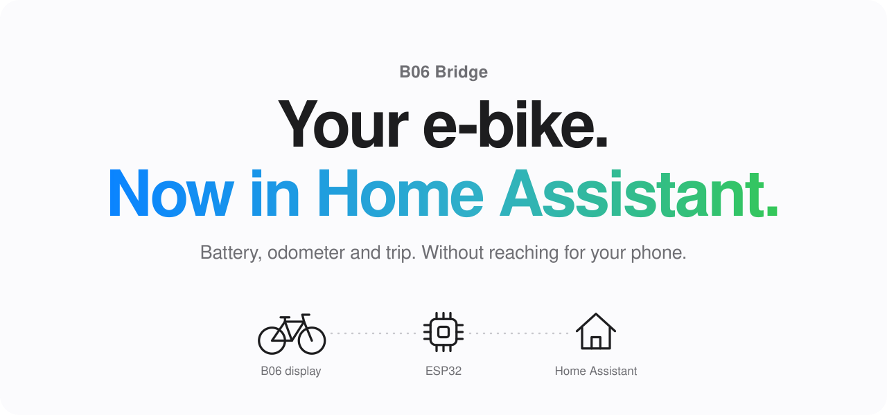
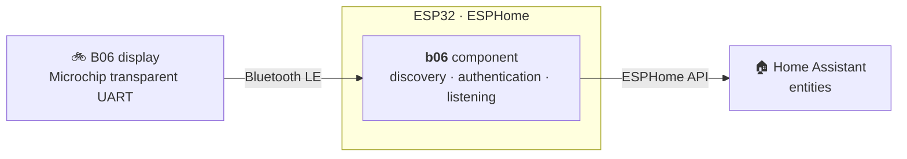

<p align="center">
  <picture>
    <source media="(prefers-color-scheme: dark)" srcset="docs/assets/hero-dark.svg">
    
  </picture>
</p>

<p align="center">
  <a href="https://github.com/stein155/b06-bridge/actions/workflows/esphome.yml"></a>
  
  
  <a href="LICENSE"></a>
</p>

<p align="center">
  <a href="#getting-started"><b>Getting started</b></a> ·
  <a href="#how-it-works"><b>How it works</b></a> ·
  <a href="#troubleshooting"><b>Troubleshooting</b></a> ·
  <a href="docs/protocol.md"><b>Protocol</b></a> ·
  <a href="CONTRIBUTING.md"><b>Contribute</b></a>
</p>

---

The B06 display, set up with the BIKEGO plus app and found on conversions such as the Bafang BBS01
mid-drive, only talks to its app, and only while your phone is next to it.

**B06 Bridge listens all the time.** It is a small ESP32 near where the bike is parked. Switch the display
on and the bridge connects by itself, with no pairing and no MAC address. Home Assistant gets the battery,
the odometer, the trip and the light.

> [!NOTE]
> Unofficial community project, not affiliated with or endorsed by any bike or display maker. Use at your
> own risk.

## Why B06 Bridge

- **🔋 Know before you go.** The last known charge stays in Home Assistant after the display
  is switched off, and after the bridge restarts.
- **🏠 Always home.** The bridge is always there, so the bike reports in whenever it is switched
  on at home, whoever rides it and wherever your phone is.
- **😴 Lets the bike sleep.** The display stays on while something is connected to it. With
  `max_connection_time` the bridge reads it, lets go, and only comes back after the bike has left and returned.
- **🚲 One bridge. Every bike.** Up to three bikes on one ESP32, which it shares with the
  [other bike bridges](#the-bike-bridges).

## The story

I run a smart home built around Home Assistant, and I like to integrate as many devices as possible into it,
including devices that do not expose a ready-made integration. It started with my Tenways CGO600, which
became [Tenways Bridge](https://github.com/stein155/tenways-bridge).

Our cargo bike has a B06 display, so for this project I reverse engineered that display's Bluetooth protocol
too. When the bike connects on departure or arrival, the bridge reads the latest data and reports it to Home
Assistant. Both bikes share the same ESP32.

## What you get

| | |
| --- | --- |
| 🔋 **Battery** | Charge in percent, kept after the display switches off and after the bridge restarts. |
| 🛣️ **Odometer** | Total distance, as a `total_increasing` sensor for long-term statistics. |
| ⏱️ **Trip** | Speed, maximum and average speed, trip distance and trip duration. |
| 💡 **Light** | A switch that turns the bike's light on and off. |
| 🏷️ **Diagnostics** | Firmware version and the BLE status (`searching`, `connecting`, `handshake`, `connected`, `paused`). |

## Supported bikes

| Display | Status |
| --- | --- |
| **B06** (`B06_BLE`), set up with the BIKEGO plus app | ✅ Tested on a cargo bike |

The B06 is a display for e-bike conversions, for example with a Bafang BBS01 mid-drive. Other displays of
the same app may work; logs from yours are welcome in an issue.

## What you need

- An **ESP32** board with Bluetooth, such as an ESP32 DevKit (`esp32dev`), and a USB cable and charger for it.
  No wiring and nothing on the bike: the bridge only listens over Bluetooth.
- A spot for it within Bluetooth range of where the bike is parked, and in reach of your WiFi.
- [Home Assistant](https://www.home-assistant.io) with the ESPHome integration, and
  [ESPHome](https://esphome.io) 2026.10 or newer to build the firmware.

## Getting started

Add the component to an [ESPHome](https://esphome.io) configuration for an ESP32:

```yaml
external_components:
  - source:
      type: git
      url: https://github.com/stein155/b06-bridge
      path: esphome/components
    components: [b06]

b06:
  max_connection_time: 30s
```

[`esphome/b06-bridge.yaml`](esphome/b06-bridge.yaml) is the complete configuration with all entities. Flash
it, add the bridge in Home Assistant under *Settings → Devices & services*, and switch the display on near
the ESP32: the BLE status goes to `connected` and the entities fill in.

| Option | Default | |
| --- | --- | --- |
| `device_names` | `[B06]` | Parts of the Bluetooth name to look for; the display advertises as `B06_BLE`. |
| `max_connection_time` | `unlimited` | How long to read the display before letting it go; at least `5s`. |

Each display takes one of the ESP32's three BLE connections; add more `b06` blocks with their own `id` for
more displays.

## How it works



- **Discovery without pairing.** The bridge connects to the first display whose Bluetooth name matches. A
  display it found that way is also recognised when it later advertises its service without a name.
- **Authentication.** The display sends a challenge, which the bridge answers the way the app does. After
  that the display pushes its data by itself. The [protocol reference](docs/protocol.md) has the details.
- **Lets the display switch off.** The B06 display stays on while a client is connected.
  `max_connection_time` disconnects after reading it for that long; the bridge then leaves the display alone
  until it has not advertised for a minute, that is after it was switched off or ridden away. The BLE status
  shows `paused` meanwhile.

## The bike bridges

B06 Bridge is one of a family of ESPHome components that each speak one make of e-bike display, built to
share a single ESP32:

| Project | Bikes | |
| --- | --- | --- |
| **B06 Bridge** (this repository) | B06 displays of the BIKEGO plus app, such as on Bafang conversions | battery, odometer, trip, light |
| [**Tenways Bridge**](https://github.com/stein155/tenways-bridge) | Tenways CGO600, CGO800 and more | battery, odometer, trip, range, power, light, rides |

A household with both kinds of bike needs one bridge, not two: add both `external_components` entries and
both blocks to the same configuration. The components ship the same `scan_coordinator.h`, through which they
share the radio: scanning keeps running as long as any bike is still searching. It stops only while a bike is
being set up, from connecting until the display is listened to, and once all of them are connected.

## Troubleshooting

| BLE status | What it means | What to try |
| --- | --- | --- |
| stays `searching` | The bridge does not see the display. | Switch the display on near the bridge. Close the BIKEGO plus app: a display accepts one connection. Check that its Bluetooth name contains one of `device_names`. |
| `connecting` or `handshake`, then back to `searching` | The display is seen, but the connection does not hold. | Move the ESP32 closer to the bike, and away from metal and other 2.4 GHz devices. |
| `paused` | Expected after `max_connection_time`. | Nothing: the bridge reads the display again once the bike has been away. |

The logs tell the rest: `esphome logs <config> --device <bridge-ip>`, the ESPHome dashboard, or USB serial at
115200 baud. [SUPPORT.md](SUPPORT.md) lists what to include in a bug report.

## For developers

| Where | What |
| --- | --- |
| [`esphome/components/b06/`](esphome/components/b06) | the component: BLE client and protocol (C++) and its ESPHome schema (Python) |
| [`esphome/`](esphome) | the complete example configuration and the development configuration |
| [`tests/`](tests) | host tests of the protocol code: frames, parsing, authentication |
| [`docs/`](docs) | the [protocol reference](docs/protocol.md) |

You do not need a bike to work on the protocol code; the host tests run on any machine with a C++17 compiler
and mbedtls:

```bash
tests/run.sh                          # host tests of the protocol code
./lint.sh                             # clang-format, ruff, yamllint, shellcheck (requirements-lint.txt)
esphome compile esphome/dev.yaml      # copy esphome/secrets.yaml.example first
esphome logs esphome/dev.yaml --device <bridge-ip>
```

CI runs the linters and the host tests, and compiles `esphome/dev.yaml` with ESPHome 2026.10.0. Only the
protocol code has automated tests; the rest is checked on a real display. Start with
[CONTRIBUTING.md](CONTRIBUTING.md).

## Thanks

B06 Bridge is built on [ESPHome](https://esphome.io) and [Home Assistant](https://www.home-assistant.io).

## Legal

B06 Bridge is licensed under the [MIT License](LICENSE).

It is an independent project, **not affiliated with, endorsed by or sponsored by any bike or display maker**.
Product names are trademarks of their owners, used only to identify the displays the bridge works with. Use
it at your own risk.
