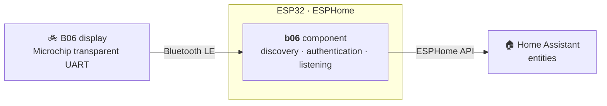

<h1 align="center">🚲 B06 Bridge</h1>

<p align="center">
  <b>Your B06 e-bike display in Home Assistant.</b><br>
  An ESP32 in the shed reads the display over Bluetooth, no app and no cloud.
</p>

<p align="center">
  <a href="https://github.com/stein155/b06-bridge/actions/workflows/esphome.yml"></a>
  
  
  <a href="LICENSE"></a>
</p>

<p align="center">
  <a href="#getting-started"><b>Getting started</b></a> ·
  <a href="#how-it-works"><b>How it works</b></a> ·
  <a href="docs/protocol.md"><b>Protocol</b></a> ·
  <a href="#development"><b>Development</b></a>
</p>

---

The B06 display, set up with the BIKEGO plus app and found on conversions such as the Bafang BBS01 mid-drive,
only talks to its app while your phone is next to the bike. **B06 Bridge turns an ESP32 into a permanent
listener.** When the display is switched on in range, the bridge connects by itself, with no pairing and no
MAC address, and Home Assistant gets the battery, the odometer, the trip and the light.

> [!NOTE]
> Unofficial community project, not affiliated with or endorsed by any bike or display maker. Use at your
> own risk.

## What you get

| | |
| --- | --- |
| 🔋 **Battery** | Charge in percent, kept after the display switches off and after the bridge restarts. |
| 🛣️ **Odometer** | Total distance, as a `total_increasing` sensor for long-term statistics. |
| ⏱️ **Trip** | Speed, maximum and average speed, trip distance and trip duration. |
| 💡 **Light** | A switch that turns the bike's light on and off. |
| 🏷️ **Diagnostics** | Firmware version and the BLE status (`searching`, `connecting`, `handshake`, `connected`, `paused`). |

## Getting started

Add the component to an [ESPHome](https://esphome.io) configuration for an ESP32:

```yaml
external_components:
  - source:
      type: git
      url: https://github.com/stein155/b06-bridge
      path: esphome/components
    components: [b06]

b06:
  max_connection_time: 30s
```

[`esphome/b06-bridge.yaml`](esphome/b06-bridge.yaml) is the complete configuration with all entities. Flash
it, add the bridge in Home Assistant under *Settings → Devices & services*, and switch the display on near
the ESP32: the BLE status goes to `connected` and the entities fill in.

| Option | Default | |
| --- | --- | --- |
| `device_names` | `[B06]` | Parts of the Bluetooth name to look for; the display advertises as `B06_BLE`. |
| `max_connection_time` | `unlimited` | How long to read the display before letting it go; at least `5s`. |

Each display takes one of the ESP32's three BLE connections; add more `b06` blocks with their own `id` for
more displays.

## How it works



- **Discovery without pairing.** The bridge connects to the first display whose Bluetooth name matches. A
  display it found that way is also recognised when it later advertises its service without a name.
- **Authentication.** The display sends a challenge, which the bridge answers the way the app does. After
  that the display pushes its data by itself. The [protocol reference](docs/protocol.md) has the details.
- **Lets the display switch off.** The B06 display stays on while a client is connected.
  `max_connection_time` disconnects after reading it for that long; the bridge then leaves the display alone
  until it has not advertised for a minute, that is after it was switched off or ridden away. The BLE status
  shows `paused` meanwhile.

## Next to other bike components

The component runs on the same ESP32 as other BLE bike components, such as
[tenways-bridge](https://github.com/stein155/tenways-bridge). Add both `external_components` entries and both
blocks. `scan_coordinator.h` is shared between them: scanning keeps running as long as any bike of any
component is still searching. It stops only while a bike is being set up, from connecting until the display is
listened to, and once all of them are connected.

## Development

```bash
tests/run.sh                          # host tests of the protocol code (needs mbedtls)
./lint.sh                             # clang-format, ruff, yamllint, shellcheck (requirements-lint.txt)
esphome compile esphome/dev.yaml      # copy esphome/secrets.yaml.example first
esphome logs esphome/dev.yaml --device <bridge-ip>
```

CI runs the linters and the host tests, and compiles `esphome/dev.yaml` with ESPHome 2026.10.0. Only the
protocol code has automated tests; the rest is checked on a real display.

## License

[MIT](LICENSE)
